<div align="center">

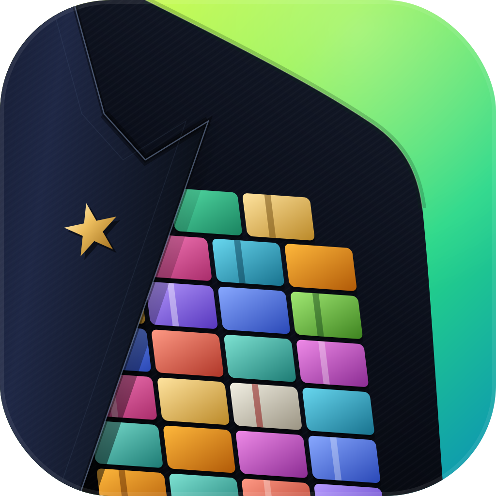

# Admiral

**Command a fleet of Claude Code agents from one native Mac app.**

Every agent gets a real terminal, a callsign, goals that stick, and a line to the rest of the fleet.
You set intent, Admiral keeps them on it and tells you when something needs you.

[](https://github.com/pedrohugorm/admiral-public/releases)


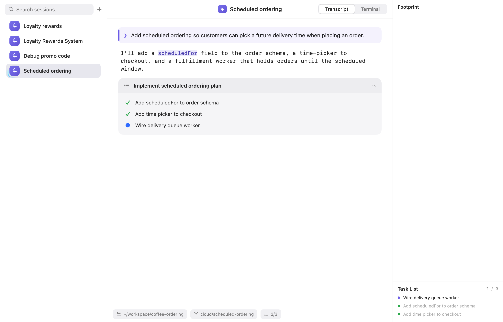

</div>

---

## Why Admiral

Running five or six Claude Code sessions in terminal tabs works until it doesn't: you lose track of
who is doing what, which branch they're on, and who silently stopped. Admiral is built around
**command by exception**. Each session carries its intent (goals), Admiral watches for the moments
that actually need you (a question, a finished goal, a PR that went red), and everything else
stays out of your way.

## Features

### A fleet in one window
Every tab runs `claude` (or a plain `zsh`) in a real PTY inside the app, with no iTerm2 or tmux required.
Sessions get a callsign, color and icon, restore on relaunch with `--resume`, and can be renamed, reordered,
forked, searched (⌘F), or promoted from a scratch tab to a permanent one. A spinning ring shows who's working
and a blue dot shows unseen finished work. The sidebar collapses to an icon rail (⌘B).

<p align="center">
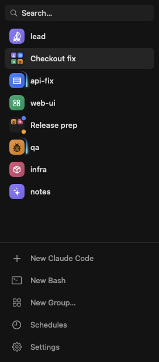
&nbsp;&nbsp;
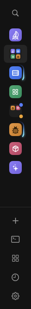
</p>

### Chat or Terminal
Switch a Claude tab between the raw terminal and a clean chat transcript with ⌘J. The chat view renders
the conversation with markdown, tool calls and live plan cards, while the terminal keeps running underneath.
*(Experimental: Settings → Experimental Features.)*

### Footprint panel
⇧⌘R opens the Footprint: the tickets the session mentioned, every repo it wrote to (flagged when it's
outside the session's root), each repo's PRs with live check, review and merge state, and the session's goals
and task list. Select a group to see the combined footprint of all its members.

<p align="center">
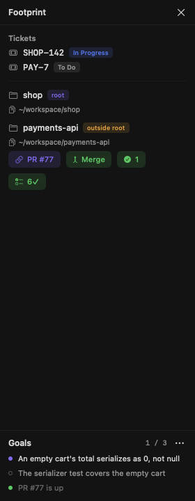
&nbsp;&nbsp;
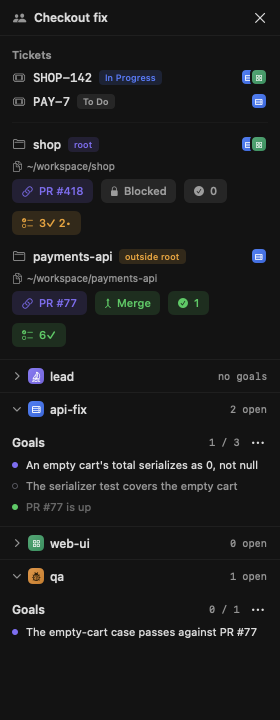
</p>

### Goals that stick
Give a session a list of short, checkable completion conditions with `set_goal`. Admiral shows them in the
Footprint, reminds the session of what's still open on every prompt, blocks it once from ending a turn with
an open goal, and nudges it when it goes idle. A new goal list is refused while old goals are still open, so a
fresh directive can't quietly erase unfinished work. Right-click a goal to mark it met, reopen it, or cancel it.

### Watchdog
Arm the watchdog on a session and it keeps that session working until its rules are satisfied. You edit
the rules, the nudge thresholds and the "how goals should be written" guidance in Settings. The guidance is a
plain file, so a session can rewrite it too.

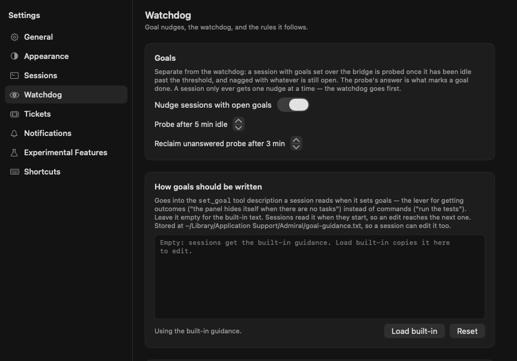

### PR watch
While a session is armed, Admiral polls the PRs on the repos it touched. It tells the session once when
checks go red, the last approval lands, the PR becomes mergeable, or it merges. A running check suite isn't news.
PR chips in the status bar and Footprint open or merge a PR in one click.

### Group chats
Put tabs in a group and they share one conversation. You and the members post to the same log, and `@name`
or `@all` wakes them. When a member asks a question with AskUserQuestion, it shows up in the group and you
answer it right there. Long agent-to-agent exchanges pause automatically until you say continue.

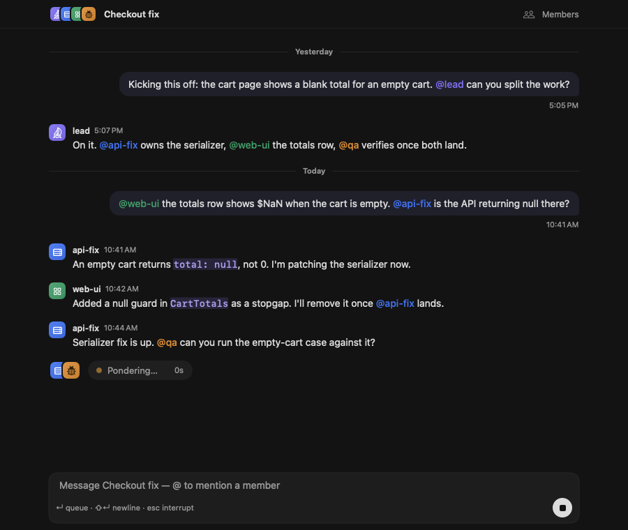

<p align="center">
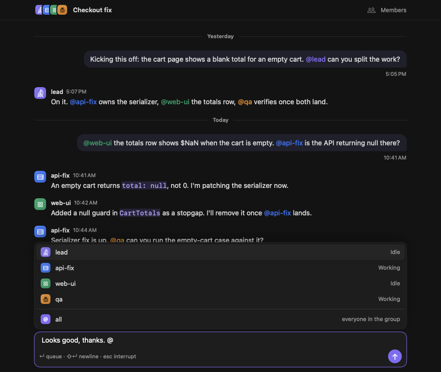
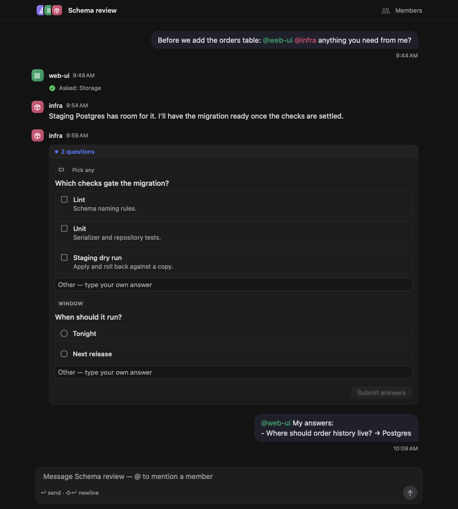
</p>
<p align="center">
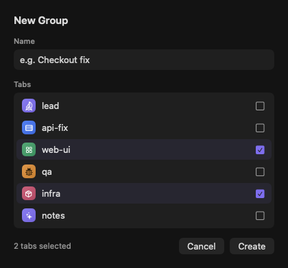
&nbsp;&nbsp;
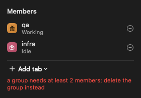
</p>

### Schedules
Send a prompt to a fresh tab in a folder on a cron schedule, like a nightly report or a weekly dependency audit.
You can pick the model and effort, open runs as scratch tabs, and require every run to answer with a JSON schema.
Each schedule keeps its run history, and **Run Now** fires it on demand.

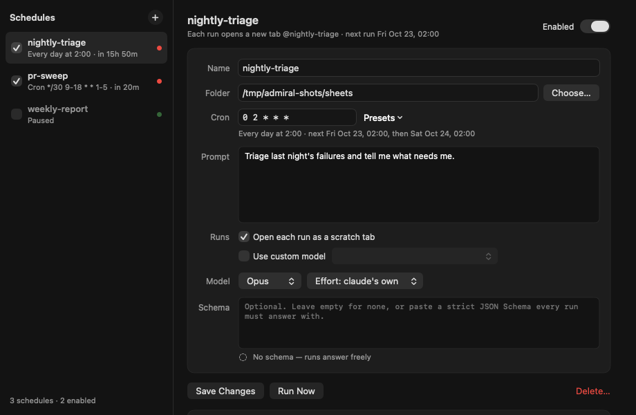

### Notifications that mean something
Native Notification Center alerts for a background tab that needs you: Claude asked a question, it needs
input, or a tab finished (watchdog done or all goals met). Each kind has its own switch, and nudges are off by default.
Sessions can also post one themselves with the bridge `notify` tool.

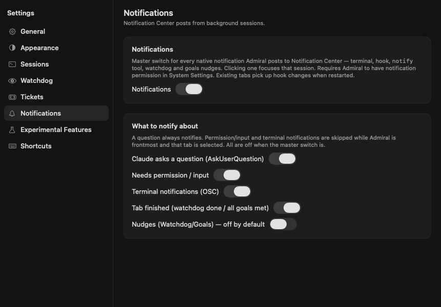

### Tickets
Admiral spots ticket keys in a session's chat (`SHOP-142`, `PAY-7`, or any pattern you add), links them to
your tracker, and, once you connect Jira with OAuth, shows each ticket's live status in the Footprint.

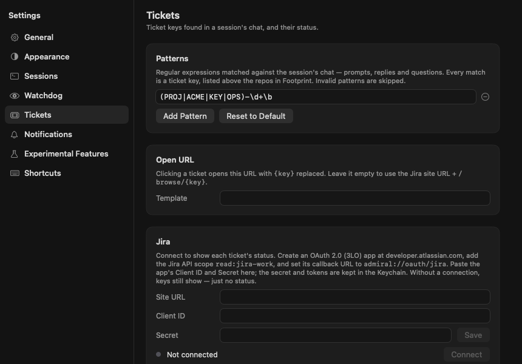

### Sessions, the way you launch them
Admiral can manage claude's launch flags so every tab behaves the same on any machine. That covers the permission
mode (`bypassPermissions` by default), the model, extra flags, an `APPEND_SYSTEM_PROMPT.md` per project, and
delivering Admiral's messages over claude's own messaging socket so they queue instead of being typed over
you. Bash tabs can reopen allowlisted TUIs like `k9s` or `htop`.

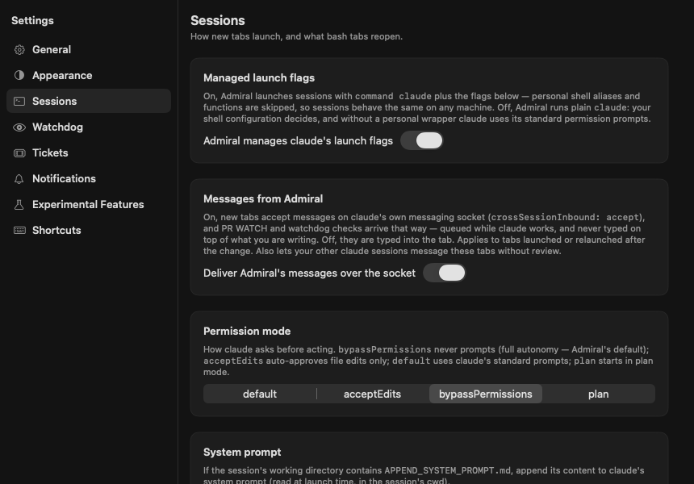

### The bridge: agents that talk to each other
Every hosted session gets Admiral's MCP bridge. Stations can see the roster, `hail` or `broadcast` to each other
(optionally asking for a reply), set and update goals, check PR status, commission new tabs, publish
structured output, run group chats and manage schedules.

| Area | Tools |
|---|---|
| Fleet | `callsign` · `roster` · `hail` · `broadcast` · `commission` · `rename_station` · `notify` |
| Goals | `set_goal` · `set_goal_self` · `add_goals` · `update_goals` |
| Work | `pr_status` · `set_structured_output` · `set_output_schema` |
| Groups | `group_create` · `group_say` · `group_log` · `group_list` · `group_add_member` · `group_remove_member` · `group_rename` · `group_delete` |
| Schedules | `schedule_set` · `schedule_list` · `schedule_run` · `schedule_history` · `schedule_delete` |

### API server and operator MCP
Turn on the local API server and Admiral serves on `127.0.0.1:4141`, with every request authenticated by a
bearer token stored in the Keychain:

- `POST /mcp`: the **operator MCP**, so you can drive the fleet from another agent or script (`list_sessions`,
  `session_status`, `read_recent`, `read_screen`, `inject`, `send_keys`, `focus`, `commission_bash`,
  `close_session`, `fleet_pr_status`).
- `POST /v1/messages`: an **Anthropic-compatible** Messages endpoint backed by your sessions.
- `GET /sessions/<callsign>/events`: a **Server-Sent Events** stream of a session's prompts, messages, tool
  calls, status changes and stops, with an optional PHI-redacted output stream.

*(Experimental: Settings → Experimental Features → Bridge & API server.)*

### Siri, Shortcuts and Spotlight
App Intents let you list sessions, check status, send a prompt, set a goal, hail, broadcast, commission or open a
session from Siri or Shortcuts. Sessions are also indexed in Spotlight.

### Keyboard-first

| | |
|---|---|
| ⌘T / ⌃⌘T | New Claude Code / New Bash |
| ⌘/ | Command palette: run an action or ask the active terminal |
| ⌘J | Chat ⇄ Terminal |
| ⇧⌘R | Footprint panel |
| ⌘F · ⌘B | Search · collapse sidebar |
| ⌘1–9 · ⌃⇥ | Jump to a session · next / previous |
| ⌃⌘A | Cycle appearance (auto / light / dark) |
| ⇧↩ | Newline in claude's prompt |

Also in the toolbar: a **keep-awake** cup (`caffeinate -u`) for long unattended runs.

### Appearance and experimental switches
Auto, light or dark, with Warp-style `#181818` dark. Features still settling in (chat view, API server, group chats)
each sit behind their own switch.

<p align="center">
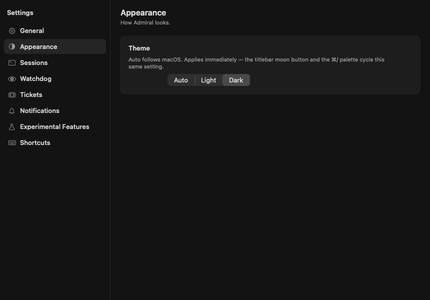
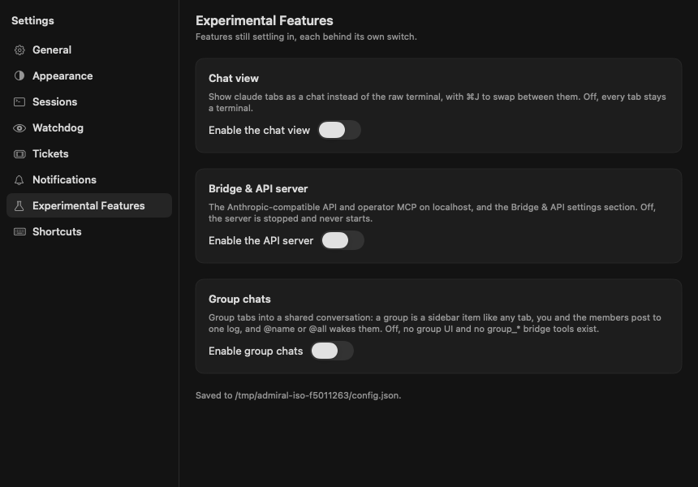
</p>

## Install

Download the latest signed and notarized DMG from **[Releases](https://github.com/pedrohugorm/admiral-public/releases)**
and drag Admiral to Applications. You need macOS 15 or later and [Claude Code](https://docs.anthropic.com/claude-code)
on your `PATH`.

## Quick start

1. Launch Admiral and press **⌘T**. Pick a folder, and a Claude Code session starts in it.
2. Give it a task, then a goal: *"set_goal: tests in payments/ pass; PR is open"*.
3. Open a few more tabs, group them (**New Group…**), and talk to all of them at once with `@all`.
4. Press **⇧⌘R** to watch repos, PRs, tickets and goals move. Admiral notifies you when a tab needs you.

## Configuration

- **Settings** (⌘,): Appearance, Sessions, Watchdog, Tickets, Bridge & API, Notifications, Experimental.
- Config file: `~/Library/Application Support/Admiral/config.json`.
- Goal guidance: `~/Library/Application Support/Admiral/goal-guidance.txt`.

## Building from source

You need Xcode 16 or later, macOS 15 or later, and `xcodegen` (`brew install xcodegen`).

```bash
cd admiral
make test                                    # AdmiralCore unit tests (fast, offline)
cd App && xcodegen generate
xcodebuild -project Admiral.xcodeproj -scheme Admiral -configuration Release \
  -derivedDataPath build build CODE_SIGNING_ALLOWED=NO
cd .. && scripts/sign-app.sh                 # Developer ID signing; see docs/signing.md
```

The screenshots in this README are drawn by the app itself from invented fixtures, in an isolated instance
(`-probeGroupsUI`, `-probeSheets`, `ADMIRAL_DEMO=1 ADMIRAL_SNAPSHOT=…`). See
[`admiral/docs/screenshots/README.md`](admiral/docs/screenshots/README.md) to regenerate them.

## Documentation

- [Feature reference](admiral/README.md)
- [Developer guide](admiral/CLAUDE.md)
- [Architecture](admiral/docs/ARCHITECTURE.md)
- [Signing](admiral/docs/signing.md) · [Releasing](admiral/docs/releasing.md)
- Design notes: [`admiral/docs/`](admiral/docs/)

## Repository layout

```
admiral/                                the app: AdmiralCore (SwiftPM) + App (xcodegen)
```
